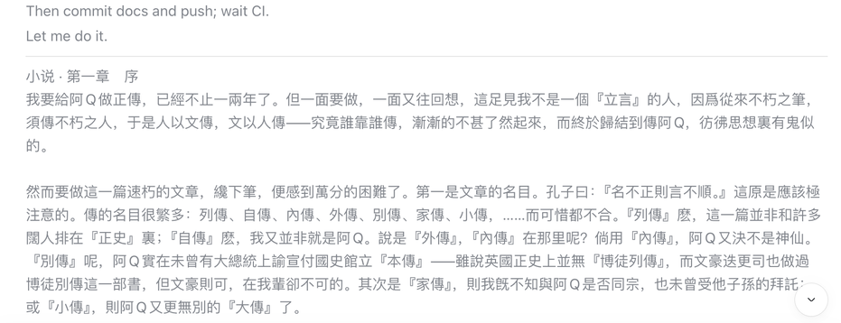
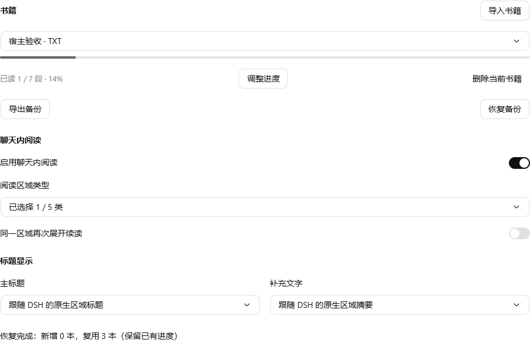

# 小说摸鱼


在 DSH 真实对话的思考、工具区域里读本地小说。展开行时，AI 的原始内容保持不变，下方用一条分隔线接上章节名和一段正文。

不写会话、不发给模型、不占上下文——等 AI 思考的空档，翻一页书。

**已发布 v1.1.0** · DSH Web 插件 · 代码 MIT 许可 · 数据只存本地

当前源码还含未发布的多页面一致性修复、进度调整与备份恢复，见 [CHANGELOG](CHANGELOG.md)。下面固定版本安装仍为已发布版，不包含这些更新。

## 效果



这是已发布版的真实阅读截图。下图为未发布源码在真实 DSH `0.2.2-rc.1` 页面里的设置区，使用公开测试书；隔离浏览器仅替换收到的插件 bundle，未安装或改变服务器上的旧版本。



原始完整动图与历史验证资料保留在 GitHub，安装包只带这两张核心预览，避免把历史测试素材全部装进浏览器 profile。

[完整界面动图](https://github.com/gongfpp/dsh-novel-fish/blob/main/docs/evidence/reading-two-expansions-110.gif)由真实运行窗口的操作前后帧按顺序合成，压缩等待时间，不是连续桌面录像；遮挡了侧栏私密信息，未改写思考或小说。实拍保留已有用户导入的 AQ TXT，未重置进度；内置 MD 的验证另见[测试报告](https://github.com/gongfpp/dsh-novel-fish/blob/main/docs/ebook-tests.md)。

## 它能做什么

- 支持 **EPUB / TXT / MD**，导入后自动分段，记住当前读到第几段
- 按中英文显示宽度、句段边界和换行量分段；小说正文限制最大展开高度，超出可滚动，原始思考与工具输出不受影响。已导入书籍不重分段、不重置进度
- 阅读区域可以选：思考、工具调用、打开文件、运行命令、文件搜索，可全选也可只挑一类
- 默认同一区域重复展开不跳段；打开「同一区域再次展开续读」后，收起再展开接着读下一段
- 标题可自定义：主标题、补充文字都支持预设和自填
- 书库、进度、设置都只存在你自己的浏览器里
- 未发布源码：同源多页面共享进度与设置，导入完成后可一键切到新书；支持调整下一段、回退和从头开始
- 未发布源码：导出 JSON 备份，可在其他浏览器合并恢复正文、进度、选书与阅读设置

## 开始读

1. 打开 **插件 → 小说摸鱼**，在选书菜单切换内置书，或导入自己的 EPUB / TXT / MD
2. 在「阅读区域类型」里勾选想读的区域（默认只勾「思考」）
3. 回到任意会话，点开一个思考或工具区域——原文下面就是分隔线、章节名和一段小说
4. 想继续读：默认换一个区域会接着下一段；也可以打开「同一区域再次展开续读」，同一区域收起再展开就继续

自动展开、或恢复展开的行保留原文但不会读小说，需要先收起，再主动展开。空选和关闭阅读都不消耗进度。

## 内置样书

下列两本直接显示在原有选书菜单，与自己导入的书统一切换、阅读和删除：

| 书名 / 版本范围 | 作者 | 格式 | 原文件大小 |
| --- | --- | --- | --- |
| [百万英镑及其他新故事（英文）](samples/ebooks/million-pound-bank-note-pg61522.txt) | Mark Twain | TXT | 385.3 KiB |
| [阿Q正传（完整九章）](samples/ebooks/aq-zheng-zhuan-wikisource.md) | 鲁迅 | 中文 MD | 66.6 KiB |

两个文件共 **462708 字节（451.9 KiB）**，首次离线加入书库；删除后刷新不恢复。升级会移除旧版默认《山海经》，将默认《阿Q正传》改为 MD 并保留进度，自己导入的副本不受影响。

英文 TXT 为 1893 年故事集，含《百万英镑》全文及另外八篇；《阿Q正传》MD 在维基文库完整九章导出前加一个 Markdown 标题，保留全部正文、贡献者和声明。

书源及独立许可收在选书菜单的「书籍信息」。PG 英文书的每个阅读片段还会显示许可要求的完整声明，并可直接离线下载完整许可；中文《阿Q正传》不增加这段 PG 声明。详见 [来源清单](samples/ebooks/sources.json)、[图书许可](samples/ebooks/LICENSE.md) 和 [测试报告](https://github.com/gongfpp/dsh-novel-fish/blob/main/docs/ebook-tests.md)。

## 设置

| 区域 | 能做什么 |
| --- | --- |
| 书库 | 导入、切换、删除书籍，查看分段进度；未发布源码另有调整进度、导出备份、恢复备份 |
| 聊天内阅读 | 总开关；勾选阅读区域类型；同一区域续读开关 |
| 标题显示 | 调整主标题与补充文字（预设或自定义） |

## 安装

需要 DSH Web `>=0.2.1-rc.2 <0.3.0-0`（0.2.1-rc.2 起，含 0.2.2 各 rc 与预发布版本）。

GitHub 固定版本安装：

```sh
dsh plugin --profile web add github:gongfpp/dsh-novel-fish#v1.1.0
```

也可以从 [发布页](https://github.com/gongfpp/dsh-novel-fish/releases) 下载 `gongfpp-dsh-novel-fish-1.1.0.tgz` 后离线安装：

```sh
dsh plugin --profile web add ./gongfpp-dsh-novel-fish-1.1.0.tgz
```

`web` 是 profile 名称，用别的 profile 时替换。

也可以从 npm 安装固定版本：

```sh
dsh plugin --profile web add @gongfpp/dsh-novel-fish@1.1.0
```

## 常见问题

**会不会消耗额度、或者把书发给模型？**
不会。插件只在浏览器里往已展开的原生行追加文本，不改会话内容，也不发起任何模型请求。

**会覆盖 AI 的思考原文吗？**
不会。原文在上，小说在下，中间是分隔线。

**书和进度存在哪里？**
存在当前站点、当前浏览器的本地数据库里，服务端不保存。已发布 v1.1.0 不支持导出；未发布源码可在书库点「导出备份」，换浏览器后「恢复备份」。备份含完整正文，请私下保存，清理站点数据前先备份。

恢复先校验文件，再确认合并：不删除当前书籍；标题、格式和每段正文及章节信息完全一致的书复用现有副本并保留当前进度，新书保留备份进度。选书与阅读设置按备份恢复。不支持超过 64 MiB 的整库 JSON，恢复期间请避免在其他页面操作书库。

**如何回退或重新读？（未发布源码）**
选书后点「调整进度」，填写下次要读的段落号（从 1 开始），或选「回退一段」「从头开始」，确认后生效。已读完仍可回退。确认会清空各页面暂存的小说片段，不影响 AI 原文；下次主动展开从新位置读。

**同时开多个页面会抢进度吗？（未发布源码）**
同浏览器、同站点共享下一段，不会各自重写旧进度；普通切换不会改动已经显示的片段。其他浏览器和不同域名不能自动同步，要使用备份。升级后请刷新所有旧页面，避免旧版代码继续写库。

**和别的阅读类插件冲突吗？**
会。多个插件抢同一个思考行时，请只启用一个。

**宿主版本不在支持范围会怎样？**
插件会失败关闭（不加载阅读行为），而不是静默降级或乱追加。

## 兼容与限制

- 声明范围 `>=0.2.1-rc.2 <0.3.0-0`；旧版阅读区在 `0.2.2-alpha.2` 实拍，当前源码的设置、导入切换、进度弹窗与备份恢复在真实 `0.2.2-rc.1` 页面隔离验收；其他版本由宿主契约探针覆盖。区间是准入策略，不等于逐版本页面验收
- `conversation.chat.reasoning.body` 是 `single` 作用域插槽：本插件与官方可选包 `cot-translation` 占同一个槽，同时启用只有优先级高的那个生效，请只装一个（详见[宿主适配与插槽说明](https://github.com/gongfpp/dsh-novel-fish/blob/main/docs/host-adapter.md)）
- 没有独立阅读页、阅读工具栏或章节跳转，阅读就发生在对话里
- 依赖宿主公开的可访问性锚点；宿主大版本更新后如果锚点变了，插件会检测不到而不是错误追加
- 键盘、悬停、触屏、展示模式切换等交互路径的补验记录见下方文档

## 更多文档

- [未发布修复与新增功能](CHANGELOG.md)
- [发布记录与安装验证](https://github.com/gongfpp/dsh-novel-fish/blob/main/docs/release.md)
- [真实页面交互验收（点击 / 悬停 / 键盘 / 触屏 / 展示模式）](https://github.com/gongfpp/dsh-novel-fish/blob/main/docs/interaction-paths-020.md)
- [宿主适配与插槽说明](https://github.com/gongfpp/dsh-novel-fish/blob/main/docs/host-adapter.md)
- [兼容验证矩阵](https://github.com/gongfpp/dsh-novel-fish/blob/main/docs/compatibility-017.md)
- [插件市场与自建索引](https://github.com/gongfpp/dsh-novel-fish/blob/main/docs/marketplace.md)

## 相关插件

- **[谢谢卡尔 · dsh-thanks-carl](https://github.com/gongfpp/dsh-thanks-carl)** — 任务完成后让卡尔从屏幕边缘探头道谢，顺带提醒喝水、吃饭、休息；纯本地，不调用模型。
- **[每轮扣款语音播报 · dsh-cost-voice](https://github.com/gongfpp/dsh-cost-voice)** — 每轮结束用支付宝或「大白饭」的声音报一句本轮花了多少钱。

## 开发

```sh
pnpm install
pnpm verify   # 构建浏览器 bundle 并跑全量测试
```

真实宿主集成测试需要把 `HOST_ROOT` 指向已安装的 DSH；CI 里已包含宿主契约探针作业。

`scripts/test-browser-samples.mjs` 用真实 bundle、真实 IndexedDB 和双页面验证阅读、迁移、进度与恢复，原语为测试替身；通过 `PLAYWRIGHT_MODULE`、`REACT_DOM_MODULE` 指向已有依赖，不自动安装浏览器。

`scripts/test-browser-host.mjs` 是手动开启的真实页面验收：设置 `GUI_URL`、`INSTALLED_PLUGIN_ROOT`、`PLAYWRIGHT_MODULE`，可用 `CHROME_EXECUTABLE` 指定浏览器。它只在独立浏览器中替换该插件的网络响应，不安装插件、不重启、不发模型消息。受认证保护的页面可指定 `AGENT_CDP_URL` 复用已登录 agent 浏览器的当前 GUI Cookie（仅内存，不输出或保存）；书库使用全新的隔离数据库。`CAPTURE_HOST` 可指定设置区截图路径。

## 许可

插件代码采用 MIT，见 [LICENSE](LICENSE)。随包图书保留各自的 Project Gutenberg、CC BY-SA 等许可，见 [图书许可说明](samples/ebooks/LICENSE.md)；代码许可不覆盖图书。
