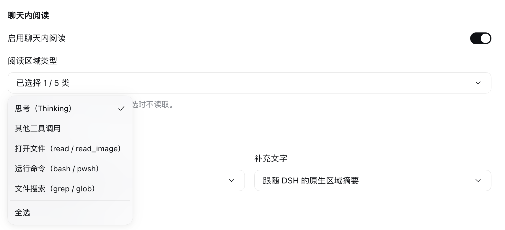

# DSH 小说摸鱼


在**真实聊天的原生思考或工具区域**中阅读本地小说：多选需要的区域类型，主动展开时保留原始内容，在明显分隔线下追加章节名和一段纯文本小说。默认重复展开不跳段、首次展开另一处所选区域才继续；也可在设置里开启同一区域续读。小说不写入会话、不发送给模型。

当前版本 **0.2.1** 的宿主范围为 **DSH Web `>=0.2.1-rc.2 <=0.2.2-alpha.2`**，包含 rc.2–rc.5 和 alpha.2。真实页面验收只在 alpha.2 完成，rc.3–rc.5 由宿主契约探针验证。没有独立阅读页、假会话、工作区入口或阅读工具栏。早于 rc.2 或晚于 alpha.2 的宿主尚不承诺兼容。

## 0.2.1：修正插件图标元信息（2026-11-04）

0.2.1 修正 0.2.0 的插件图标元信息问题：0.2.0 在插件管理页显示「包元信息错误」并回退到默认图标，原因是包内 `assets/icon.png` 为 372 KiB，超过宿主 256 KiB 的图标上限；包清单也没有声明 `icon`，只提供了 `./icon` 导出。0.2.1 把图标压到 61 KiB（512×512 调色板 PNG，保留透明圆角），并在 `package.json` 显式声明 `"icon": "./assets/icon.png"`。阅读行为、宿主范围与 0.2.0 完全相同，`lib/client.js` 未变。细节见 [图标元信息修正记录](docs/icon-metadata-021.md)。

## 0.2.0：1.0 功能定稿、alpha.2 兼容与同区域续读（已发布）

0.2.0 是 1.0 的功能基线：合并 0.1.6 的兼容声明与发布记录、0.1.7 的兼容候选和 0.1.8 的阅读行为，之后 1.0 只收敛验证覆盖，不再改阅读功能。浏览器端书库不导出、也不额外持久化到别处：清空站点数据后重新导入原书文件即可；发布记录继续手工维护。

兼容声明从 0.1.6 的 `>=0.2.1-rc.2 <0.3.0-0` 收紧为 `>=0.2.1-rc.2 <=0.2.2-alpha.2`：区间只是准入策略，不是验收结论；收紧后不在实测与探针范围内的宿主会失败关闭，而不是静默降级。0.1.7 的矩阵与限制见 [兼容验证记录](docs/compatibility-017.md)；本版新增行为、探针第 7 项和验证范围见 [0.2.0 记录](docs/continuous-reading-020.md)。

同时新增「同一区域再次展开续读」开关（默认关闭，关闭时行为与之前相同），并把聊天 DOM 观察合并到一帧，避免流式输出时每个 token 都全量重扫。运行代码与 0.1.8 候选相同；真实页面验收在候选包上完成：装着 0.1.7 的实例安装后客户端热更新、无需刷新页面，续读开关与跨区域续读按预期工作。尚未进入本版的 1.0 事项：真实聊天键盘/悬停/触屏、展示模式与过程分组折叠 reset 等交互路径的补验，以及把宿主探针接进 CI。

0.2.0 已通过 GitHub Release 发布，npm 未发布；0.2.1 于 2026-11-04 修复图标元信息并发布，当前安装入口见下方「安装 0.2.1」。索引里的 0.1.6 及更早条目保留各自当时的兼容声明，不追溯改写。

## 0.1.6：宿主兼容范围

0.1.6 不改阅读行为，只调整宿主兼容声明：`engines.dsh` 从精确值 `0.2.1-rc.2` 改为区间 `>=0.2.1-rc.2 <0.3.0-0`，使 rc.3 及之后的 0.2.x 宿主可以在 preflight 中安装本插件；同时首次把 0.1.5 以来的原生设置版本同步发布到 npm。**区间是准入策略，不是验收结论**：真实宿主上完整跑过的仍然只有 `0.2.1-rc.2`，rc.3+ 的 GUI 行为未实测。[发布记录](docs/release.md)

## 0.1.5：原生设置

设置位于 **插件 → 小说摸鱼详情页**。按钮、开关、下拉多选、自定义输入和删除确认复用 DSH 原生组件，移除浏览器默认文件按钮和重复外框；书库、进度和聊天阅读行为不变。真实 DSH 已验证多选全选、自定义输入框及系统文件选择器。完整范围与未验项见 [0.1.5 验收记录](docs/native-settings-update.md)。



## 开始读

1. 在 **插件** 页启用 **小说摸鱼**，点卡片进入本插件详情页。不依赖旧版本；不要同时启用两个接管思考的阅读插件。旧 npm **0.1.4** 的设置仍在通用设置中，要使用新入口请安装下方 GitHub **0.2.1**，或等价的本页离线包。
2. 导入 `.epub`、`.txt` 或 `.md`，用“当前书籍”下拉选择一本书。旁边显示自动保存的分段进度，并可删除选中书籍。不提供粘贴文本入口。
3. 打开“阅读区域类型”下拉，勾选 **思考 / 工具调用 / 打开文件 / 运行命令 / 文件搜索**，可全选或全不选。五类不重叠，适用于任意会话中的对应原生区域，无需选择具体步骤。
4. 图标和箭头固定跟随 DSH 原生行为。主标题、补充文字用下拉预设；选择“自定义…”才出现输入框。空主标题保持各区域自己的原生标题。
5. 返回聊天，主动展开所选原生区域。原始思考或工具输入输出在上，横线、章节和小说在下；不覆盖原文，不改模型回答。已完成历史区域同样可用。不可展开的卡片不生成额外控件。

自动展开或已恢复展开的区域保留原文，但不读取小说；需要先收起，再主动展开。空选和关闭阅读都不消耗进度。设置页只管理书籍和显示，不是阅读入口。

## 安装 0.2.1

已有可运行的 DSH Web `>=0.2.1-rc.2 <=0.2.2-alpha.2` 后，使用 GitHub 固定版本：

```sh
dsh plugin --profile web add github:gongfpp/dsh-novel-fish#v0.2.1
```

发布版本包含浏览器构建产物，无需先安装开发依赖。也可从 [v0.2.1 发布页](https://github.com/gongfpp/dsh-novel-fish/releases/tag/v0.2.1) 下载 `gongfpp-dsh-novel-fish-0.2.1.tgz`：

```sh
dsh plugin --profile web add ./gongfpp-dsh-novel-fish-0.2.1.tgz
```

**npm 当前为 0.1.6，0.2.1 尚未发布到 npm。** 公共市场的 npm 入口可能仍指向旧版；请使用上面的 GitHub 固定版本或本页附件，发布状态以 [发布记录](docs/release.md) 为准。

`web` 是 profile 名称；使用其他 profile 时替换它。升级保留当前浏览器的书库和进度。安装后客户端通常热更新、无需刷新；若未加载新代码，刷新现有 DSH 页面；仍未生效再重启原来的 `dsh web`，不要另开服务器。发布与安装验证范围见 [发布记录](docs/release.md)。

### 已收录的公共可搜索市场

- **[Awesome DSH Plugin](https://awesome-dsh-plugin.com/)**：官网原生安装索引已收录 npm **0.1.4**。在 DSH「插件 → 发现」添加 `https://awesome-dsh-plugin.com/index.json`，搜索 **dsh-novel-fish** 或 **小说摸鱼**。2026-10-28 核验时，无版本 jsDelivr 镜像仍返回旧目录；优先使用上述官网地址，已有该源则刷新。官方索引解析和隔离 CLI 安装已验证，未声称完成本轮 GUI 安装实拍。
- **[Open Plugin Market](https://dshopen.org/)**：已审核收录 0.1.4。在 DSH「插件 → 发现 → 索引源」添加 `https://dshopen.org/index.json`，搜索 **小说摸鱼** 并选择 0.1.4 安装；使用已固定 Git 提交的发布版本，不依赖 npm。
- **[DSH Market](https://dshmarket.com/)**：可视化市场已收录 **dsh-novel-fish**，支持搜索及 GitHub Release 包安装。尚未安装市场插件的用户可以运行 `dsh plugin --profile web add dshmarket`，重启 `dsh web` 后打开「插件 → Plugin Market」；[在线详情页](https://awesome-dsh-plugin.com/p/gongfpp/dsh-novel-fish/)也提供安装命令。

以上收录均已核对公开市场数据；不代表已在所有客户端完成 GUI 实测。**宿主兼容范围声明为 `>=0.2.1-rc.2 <=0.2.2-alpha.2`，真实页面验收过的宿主为 DSH Web 0.2.2-alpha.2，rc.3–rc.5 由宿主契约探针验证**。[其他社区收录状态](docs/community-markets.md)另行列出。

### DSH 自定义插件市场

DSH 当前没有默认的统一第三方插件目录。本项目提供符合官方格式的**自建索引源**，不代表官方审核或推荐：

```text
https://raw.githubusercontent.com/gongfpp/dsh-novel-fish/main/index.json
```

在「发现」页添加索引后安装 **小说摸鱼 0.2.1**；已添加本索引的用户刷新索引后查看新版本。若没有「发现」页，先启用实验性功能中的「自定义插件索引」（旧版名称「自定义插件市场」）。完整说明见 [市场接入说明](docs/marketplace.md)。

**先停用其他接管思考渲染的阅读插件。** 不依赖旧插件，也不支持两个阅读插件叠加运行。

## 续读规则

- 当前页面首次主动展开所选区域 A：读取并成功保存进度后，在原文末尾追加一段。默认收起再展开 A 仍用缓存。
- 开启「同一区域再次展开续读」后：收起再主动展开 A 会接着读下一段；自动恢复展开和程序化展开仍不读，缓存键仍是同一个。
- 首次主动展开另一处所选区域 B：读取下一段。缓存跨组件重挂载保留，不依赖模型是否正在运行。
- 自动恢复展开、加载历史、流式更新和模型结束不加载小说，不覆盖真实内容。
- 刷新后缓存清空；再次主动展开旧 A，从这本书保存的进度继续，不恢复旧片段。
- 切书清空临时缓存，各书分别保存进度；读取失败不推进，书末停止、不循环。
- 初次加载书库失败时禁止覆盖未知的已存数据，并明确报错。

## 文件与本地数据

EPUB 使用 **epubjs 的 Container、Packaging、Navigation 解析器**解析容器、OPF 和导航，按 linear spine 顺序读取 XHTML。ZIP 与 XML 读取失败直接报错。只抽取正文，不执行脚本、不加载书内图片或外部资源，不复刻原书排版。

TXT/MD 保留基本段落、章节；默认每段约 600 个 Unicode 字符，优先在段落/句子边界结束。支持严格 UTF-8 和带 BOM 的 UTF-16LE/BE，未知编码明确报错，不乱码入库；GBK 请先另存 UTF-8。导入只解析一次，聊天按需读一个已分好的段落。EPUB 仅分块解压实际使用项并校验 CRC，累计读取上限 128 MiB；这不是峰值内存保证，解码、XML 和整本分段另需内存。**EPUB 图片不显示，纯图片书不支持。**

书籍、段落、设置和每本书的进度存在当前浏览器、当前站点的 IndexedDB。设置保存区域**类型**，不保存会话／步骤位置列表或小说绑定；片段缓存只在当前页面插件实例内。不同浏览器/站点不共享，不提供多标签同步。升级本插件时保留原书库和进度，清理站点数据则会删除书库；本插件不提供书库导出，也不把数据写回其他存储，清空后重新导入原书文件即可（该书进度从第 1 段重新开始）。只导入你有权使用的内容。

## 兼容与历史验收

原生正文插槽不提供标题接口。本插件对具体 DSH DOM 标记中的文字做窄适配，更新原生 shimmer 文字层；不覆盖原生图标、按钮、箭头、布局或事件。0.2.0 起宿主契约探针为 7 项，新增检查标题 shimmer 层、DisclosureRow、会话身份和 turn-process 折叠锚点是否仍在。思考原文仍用官方 Factory，工具原文节点保持；小说以自己的分隔线和纯文本追加。不替换聊天根节点，不修改 DSH 安装文件。具体定位、工具末尾 DOM 适配和限制见 [宿主适配说明](docs/host-adapter.md)。

0.1.4 发布时通过 93 项自动测试（含市场源契约），受 Cua 绑定限制，**未宣称完成该轮人工悬停、键盘及真实 A/B/C 全流程**。0.1.5 仅补验设置的原生外观与部分交互，不把设置截图当作聊天阅读补验；本轮未重新完成真实聊天 A/B/C、键盘和悬停全流程。新版验证、七项修复和手工清单见 [0.1.4 记录](docs/multi-region-update.md)。[0.1.3 原生显示记录](docs/native-disclosure-update.md) 和 [0.1.2 追加阅读记录](docs/type-append-update.md) 仅为历史证据。

[历史验收记录](docs/acceptance.md) 与 [0.1.1 设置改进](docs/settings-update.md) 保留各自版本的验证范围，不替代本轮运行证据。


## 开发

Node.js 24.19.0、pnpm 12.11.2 为此次构建环境：

```sh
pnpm install --frozen-lockfile --ignore-scripts
pnpm verify
pnpm pack
```

安装不批准依赖脚本，构建使用 esbuild 平台二进制。运行依赖打入客户端产物，普通用户安装压缩包无需运行开发脚本。

- [client.js](src/client.js)：客户端入口与详情页设置注册；[chat-adapter.js](src/chat-adapter.js)：聊天区域的窄适配。
- [store.js](src/store.js) / [persistence.js](src/persistence.js)：页面缓存、串行读写及本地持久化。
- [segments.js](src/segments.js) / [epub.js](src/epub.js)：导入解析和统一分段。
- [settings.js](src/settings.js)：最小设置。

## 许可

本项目为 MIT；书本图标为项目维护者提供的位图（`assets/icon.png`）。构建时生成 [第三方依赖许可](THIRD-PARTY-NOTICES.txt)，包含 JSZip 预打包的子依赖声明。旧仓库仅作只读行为参考，没有复制其独立阅读、工作区或兼容状态系统。
