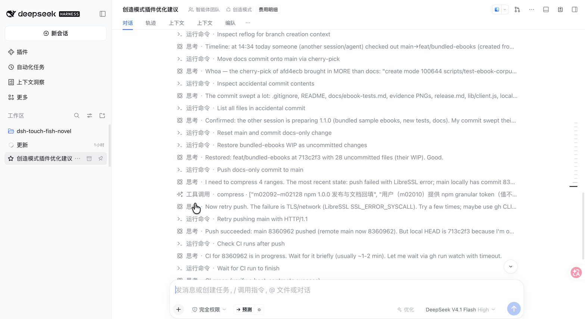

# 小说摸鱼


在 DSH 真实对话的思考、工具区域里读本地小说。展开行时，AI 的原始内容保持不变，下方用一条分隔线接上章节名和一段正文。

不写会话、不发给模型、不占上下文——等 AI 思考的空档，翻一页书。

**v1.1.0** · DSH Web 插件 · 代码 MIT 许可 · 数据只存本地

## 效果



*1567 × 856 原尺寸动图，保留 DeepSeek Harness 标识、导航、项目侧栏与完整对话区。实际展开两条不同的思考：原文仍在，分隔线下接续小说；收起即隐藏。*

动图由真实运行窗口的操作前后帧按顺序合成，压缩等待时间，不是连续桌面录像；仅裁掉浏览器外框、底部统计并遮挡侧栏私密会话/账户，未改写思考或小说。实拍保留已有用户导入的 AQ TXT，未重置其进度；新版内置 MD 的验证另见[测试报告](docs/ebook-tests.md)。[原尺寸 GIF](docs/evidence/reading-two-expansions-110.gif) · [画面与哈希记录](docs/evidence/reading-two-expansions-110.json)

## 它能做什么

- 支持 **EPUB / TXT / MD**，导入后自动分段，记住当前读到第几段
- 按中英文显示宽度、句段边界和换行量分段；小说正文限制最大展开高度，超出可滚动，原始思考与工具输出不受影响。已导入书籍不重分段、不重置进度
- 阅读区域可以选：思考、工具调用、打开文件、运行命令、文件搜索，可全选也可只挑一类
- 默认同一区域重复展开不跳段；打开「同一区域再次展开续读」后，收起再展开接着读下一段
- 标题可自定义：主标题、补充文字都支持预设和自填
- 书库、进度、设置都只存在你自己的浏览器里

## 开始读

1. 打开 **插件 → 小说摸鱼**，在选书菜单切换内置书，或导入自己的 EPUB / TXT / MD
2. 在「阅读区域类型」里勾选想读的区域（默认只勾「思考」）
3. 回到任意会话，点开一个思考或工具区域——原文下面就是分隔线、章节名和一段小说
4. 想继续读：默认换一个区域会接着下一段；也可以打开「同一区域再次展开续读」，同一区域收起再展开就继续

自动展开、或恢复展开的行保留原文但不会读小说，需要先收起，再主动展开。空选和关闭阅读都不消耗进度。

## 内置样书

下列两本直接显示在原有选书菜单，与自己导入的书统一切换、阅读和删除：

| 书名 / 版本范围 | 作者 | 格式 | 原文件大小 |
| --- | --- | --- | --- |
| [百万英镑及其他新故事（英文）](samples/ebooks/million-pound-bank-note-pg61522.txt) | Mark Twain | TXT | 385.3 KiB |
| [阿Q正传（完整九章）](samples/ebooks/aq-zheng-zhuan-wikisource.md) | 鲁迅 | 中文 MD | 66.6 KiB |

两个文件共 **462708 字节（451.9 KiB）**，首次离线加入书库；删除后刷新不恢复。升级会移除旧版默认《山海经》，将默认《阿Q正传》改为 MD 并保留进度，自己导入的副本不受影响。

英文 TXT 为 1893 年故事集，含《百万英镑》全文及另外八篇；《阿Q正传》MD 在维基文库完整九章导出前加一个 Markdown 标题，保留全部正文、贡献者和声明。

书源及独立许可收在选书菜单的「书籍信息」。PG 英文书的每个阅读片段还会显示许可要求的完整声明，并可直接离线下载完整许可；中文《阿Q正传》不增加这段 PG 声明。详见 [来源清单](samples/ebooks/sources.json)、[图书许可](samples/ebooks/LICENSE.md) 和 [测试报告](docs/ebook-tests.md)。

## 设置

| 区域 | 能做什么 |
| --- | --- |
| 书库 | 导入、切换、删除书籍，查看分段进度 |
| 聊天内阅读 | 总开关；勾选阅读区域类型；同一区域续读开关 |
| 标题显示 | 调整主标题与补充文字（预设或自定义） |

## 安装

需要 DSH Web `>=0.2.1-rc.2 <0.3.0-0`（0.2.1-rc.2 起，含 0.2.2 各 rc 与预发布版本）。

GitHub 固定版本安装：

```sh
dsh plugin --profile web add github:gongfpp/dsh-novel-fish#v1.1.0
```

也可以从 [发布页](https://github.com/gongfpp/dsh-novel-fish/releases) 下载 `gongfpp-dsh-novel-fish-1.1.0.tgz` 后离线安装：

```sh
dsh plugin --profile web add ./gongfpp-dsh-novel-fish-1.1.0.tgz
```

`web` 是 profile 名称，用别的 profile 时替换。

也可以从 npm 安装固定版本：

```sh
dsh plugin --profile web add @gongfpp/dsh-novel-fish@1.1.0
```

## 常见问题

**会不会消耗额度、或者把书发给模型？**
不会。插件只在浏览器里往已展开的原生行追加文本，不改会话内容，也不发起任何模型请求。

**会覆盖 AI 的思考原文吗？**
不会。原文在上，小说在下，中间是分隔线。

**书和进度存在哪里？**
存在当前浏览器的本地数据库里。插件不提供导出，换浏览器或清空站点数据后重新导入原书即可。

**和别的阅读类插件冲突吗？**
会。多个插件抢同一个思考行时，请只启用一个。

**宿主版本不在支持范围会怎样？**
插件会失败关闭（不加载阅读行为），而不是静默降级或乱追加。

## 兼容与限制

- 声明范围 `>=0.2.1-rc.2 <0.3.0-0`；真实页面验收在 `0.2.2-alpha.2` 完成，`0.2.1-rc.2` 至 rc.5 与 `0.2.2-rc.1` 由宿主契约探针（7 项）验证。区间是准入策略，不等于逐版本页面验收
- 没有独立阅读页、阅读工具栏或章节跳转，阅读就发生在对话里
- 依赖宿主公开的可访问性锚点；宿主大版本更新后如果锚点变了，插件会检测不到而不是错误追加
- 键盘、悬停、触屏、展示模式切换等交互路径的补验记录见下方文档

## 更多文档

- [发布记录与安装验证](docs/release.md)
- [真实页面交互验收（点击 / 悬停 / 键盘 / 触屏 / 展示模式）](docs/interaction-paths-020.md)
- [宿主适配与插槽说明](docs/host-adapter.md)
- [兼容验证矩阵](docs/compatibility-017.md)
- [插件市场与自建索引](docs/marketplace.md)

## 开发

```sh
pnpm install
pnpm verify   # 构建浏览器 bundle 并跑全量测试
```

真实宿主集成测试需要把 `HOST_ROOT` 指向已安装的 DSH；CI 里已包含宿主契约探针作业。

## 许可

插件代码采用 MIT，见 [LICENSE](LICENSE)。随包图书保留各自的 Project Gutenberg、CC BY-SA 等许可，见 [图书许可说明](samples/ebooks/LICENSE.md)；代码许可不覆盖图书。
