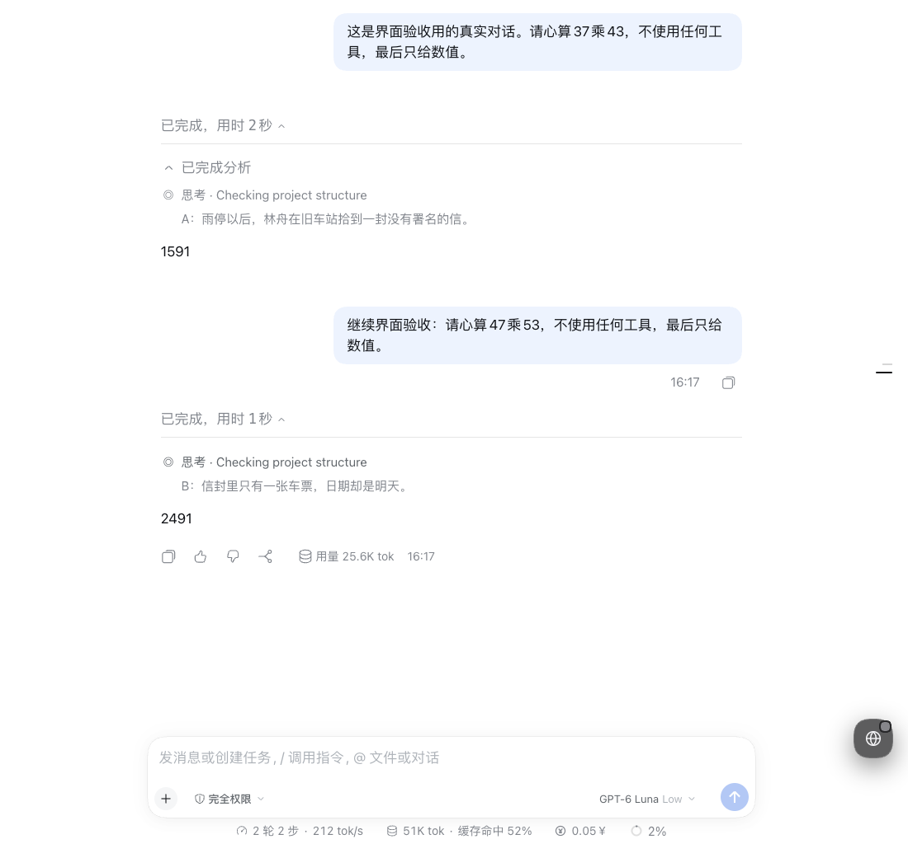
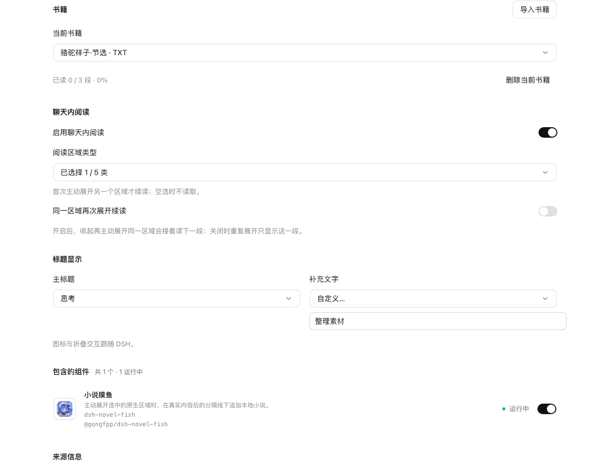

# 小说摸鱼


在 DSH 真实对话的思考、工具区域里读本地小说。展开行时，AI 的原始内容保持不变，下方用一条分隔线接上章节名和一段正文。

不写会话、不发给模型、不占上下文——等 AI 思考的空档，翻一页书。

**v1.0.1** · DSH Web 插件 · MIT 许可 · 数据只存本地

## 效果



*演示会话实拍：展开思考行后，原生内容下方追加了两段小说，读到哪里自动记住。*

## 它能做什么

- 支持 **EPUB / TXT / MD**，导入后自动分段，记住当前读到第几段
- 阅读区域可以选：思考、工具调用、打开文件、运行命令、文件搜索，可全选也可只挑一类
- 默认同一区域重复展开不跳段；打开「同一区域再次展开续读」后，收起再展开接着读下一段
- 标题可自定义：主标题、补充文字都支持预设和自填
- 书库、进度、设置都只存在你自己的浏览器里

## 开始读

1. 打开 **插件 → 小说摸鱼**，导入一本书并确认「当前书籍」选中它
2. 在「阅读区域类型」里勾选想读的区域（默认只勾「思考」）
3. 回到任意会话，点开一个思考或工具区域——原文下面就是分隔线、章节名和一段小说
4. 想继续读：默认换一个区域会接着下一段；也可以打开「同一区域再次展开续读」，同一区域收起再展开就继续

自动展开、或恢复展开的行保留原文但不会读小说，需要先收起，再主动展开。空选和关闭阅读都不消耗进度。

## 设置

| 区域 | 能做什么 |
| --- | --- |
| 书库 | 导入、切换、删除书籍，查看分段进度 |
| 聊天内阅读 | 总开关；勾选阅读区域类型；同一区域续读开关 |
| 标题显示 | 调整主标题与补充文字（预设或自定义） |



## 安装

需要 DSH Web `>=0.2.1-rc.2 <0.3.0-0`（0.2.1-rc.2 起，含 0.2.2 各 rc 与预发布版本）。

GitHub 固定版本安装：

```sh
dsh plugin --profile web add github:gongfpp/dsh-novel-fish#v1.0.1
```

也可以从 [发布页](https://github.com/gongfpp/dsh-novel-fish/releases) 下载 `gongfpp-dsh-novel-fish-1.0.1.tgz` 后离线安装：

```sh
dsh plugin --profile web add ./gongfpp-dsh-novel-fish-1.0.1.tgz
```

`web` 是 profile 名称，用别的 profile 时替换。

也可以从 npm 安装固定版本：

```sh
dsh plugin --profile web add @gongfpp/dsh-novel-fish@1.0.1
```

## 常见问题

**会不会消耗额度、或者把书发给模型？**
不会。插件只在浏览器里往已展开的原生行追加文本，不改会话内容，也不发起任何模型请求。

**会覆盖 AI 的思考原文吗？**
不会。原文在上，小说在下，中间是分隔线。

**书和进度存在哪里？**
存在当前浏览器的本地数据库里。插件不提供导出，换浏览器或清空站点数据后重新导入原书即可。

**和别的阅读类插件冲突吗？**
会。多个插件抢同一个思考行时，请只启用一个。

**宿主版本不在支持范围会怎样？**
插件会失败关闭（不加载阅读行为），而不是静默降级或乱追加。

## 兼容与限制

- 声明范围 `>=0.2.1-rc.2 <0.3.0-0`；真实页面验收在 `0.2.2-alpha.2` 完成，`0.2.1-rc.2` 至 rc.5 与 `0.2.2-rc.1` 由宿主契约探针（7 项）验证。区间是准入策略，不等于逐版本页面验收
- 没有独立阅读页、阅读工具栏或章节跳转，阅读就发生在对话里
- 依赖宿主公开的可访问性锚点；宿主大版本更新后如果锚点变了，插件会检测不到而不是错误追加
- 键盘、悬停、触屏、展示模式切换等交互路径的补验记录见下方文档

## 更多文档

- [发布记录与安装验证](docs/release.md)
- [真实页面交互验收（点击 / 悬停 / 键盘 / 触屏 / 展示模式）](docs/interaction-paths-020.md)
- [宿主适配与插槽说明](docs/host-adapter.md)
- [兼容验证矩阵](docs/compatibility-017.md)
- [插件市场与自建索引](docs/marketplace.md)

## 相关插件

- **[谢谢卡尔 · dsh-thanks-carl](https://github.com/gongfpp/dsh-thanks-carl)** — 任务完成后让卡尔从屏幕边缘探头道谢，顺带提醒喝水、吃饭、休息；纯本地，不调用模型。
- **[每轮扣款语音播报 · dsh-cost-voice](https://github.com/gongfpp/dsh-cost-voice)** — 每轮结束用支付宝或「大白饭」的声音报一句本轮花了多少钱。

## 开发

```sh
pnpm install
pnpm verify   # 构建浏览器 bundle 并跑全量测试
```

真实宿主集成测试需要把 `HOST_ROOT` 指向已安装的 DSH；CI 里已包含宿主契约探针作业。

## 许可

MIT，见 [LICENSE](LICENSE)。
