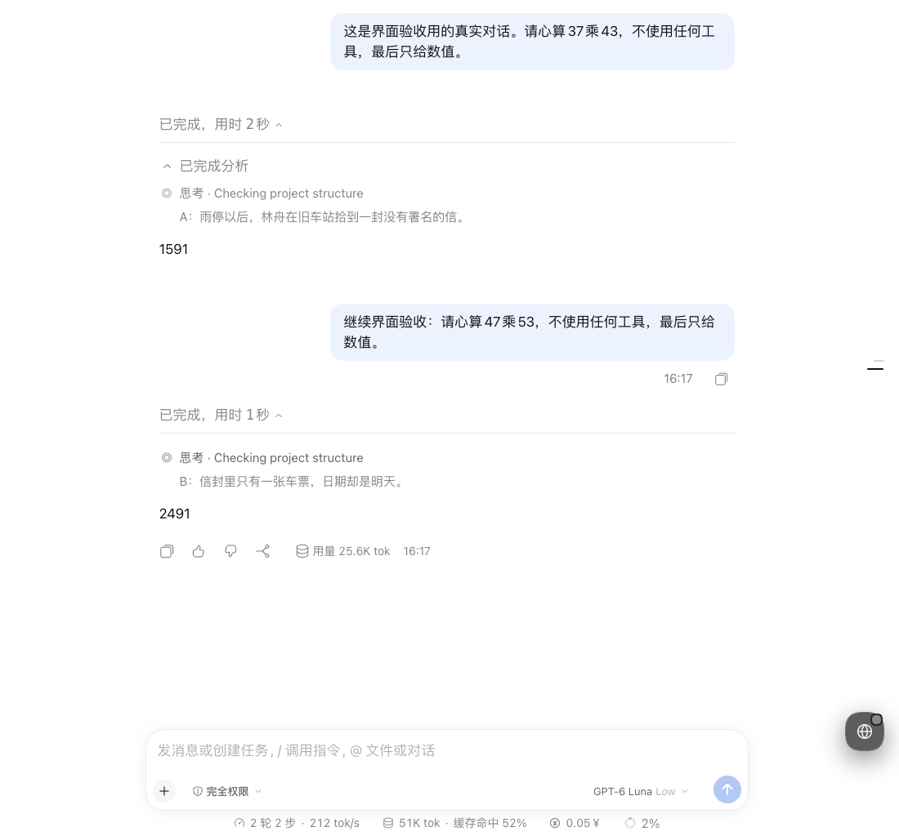

# DSH 小说摸鱼

只在**真实聊天中选中的思考步骤**里阅读本地小说。主动展开一处读一段；重复展开不跳段，另一处首次展开才继续。小说不混入模型思考、不写入会话、不发送给模型。

适配 **DSH Web 0.2.1-rc.2**。没有独立阅读页、假会话、工作区入口或阅读工具栏。



## 安装

交付的压缩包已经包含浏览器构建产物，不需要先装开发依赖。下载到当前目录后：

```sh
dsh plugin --profile web add ./local-dsh-touch-fish-novel-0.1.0.tgz
```

也可从此源码目录安装，使用实际绝对路径：

```sh
dsh plugin --profile web add /Users/mass/Developer/Playground/dsh-touch-fish-novel
```

本地路径与 tarball 安装命令均已实际执行成功，tarball 已在真实聊天中复测。安装后刷新现有 DSH 页面；若更换已安装版本仍未加载新代码，重启原来的 `dsh web`，不要另开一个服务器。

**先停用其他接管思考渲染的阅读插件。** 此环境原有阅读插件在同一区域发生 `renderSlot is not a function`；隔离验收时只关闭了其启用开关，没有修改旧项目源码或删除数据。不支持同时叠加两个阅读插件。

## 开始读

1. 在 **插件** 页启用 **小说摸鱼**（先停用旧阅读插件），进入 **账号菜单 → 设置 → 通用设置 → 小说摸鱼**。
2. 导入 `.epub`、`.txt`、`.md`，或粘贴文本；在书籍列表选中一本书。
3. 设置图标、主标题、补充文字。空主标题使用 DSH 当前语言的“思考”。图标输入符号或 emoji。
4. 点 **选择目标思考步骤**，关闭设置窗口，在真实聊天中点选一个或多个思考步骤。选择动作不消费小说；再回到设置点 **完成选择**。
5. 主动展开目标步骤阅读。已完成的历史步骤同样可用；如果 DSH 折叠了外层“已完成／工作过程”分组，先按原生交互展开该分组。

没有可见思考正文的步骤不能用作阅读区。设置页只管理书籍和定位，不展示小说供阅读。

## 续读规则

- 当前页面首次主动展开目标 A：读取并成功保存进度后展示一段。收起再展开 A 仍用缓存。
- 首次主动展开目标 B：读取下一段。缓存跨组件重挂载保留，不绑定小说、会话生命周期或模型运行状态。
- 自动恢复展开、加载历史、流式更新和模型结束不加载小说。
- 刷新后缓存清空；再次主动展开旧 A，从这本书保存的进度继续，不恢复旧片段。
- 切书清空临时缓存，各书分别保存进度；读取失败不推进，书末停止、不循环。
- 初次加载书库失败时禁止覆盖未知的已存数据，并明确报错。

## 文件与本地数据

EPUB 使用 **epubjs 的 Container、Packaging、Navigation 解析器**解析容器、OPF 和导航，按 linear spine 顺序读取 XHTML。ZIP 与 XML 读取失败直接报错，不依赖电子书渲染器的异步页面生命周期。只抽取正文；不执行脚本、不加载书内图片或外部资源，不复刻原书排版。

TXT/MD 保留基本段落、章节；默认每段约 600 个 Unicode 字符，优先在段落/句子边界结束。导入时解析一次，聊天每次只读取一个已经分好的段落。EPUB 累计解压读取上限为 128 MiB；整本导入需要本地内存，极大文件可能受浏览器资源限制。

书籍、段落、设置和每本书的进度存在当前浏览器、当前站点的 IndexedDB。目标定位属于设置，**不含片段索引或小说绑定**；片段缓存只在当前页面的插件实例内。不同浏览器/站点不共享，不提供多标签同步或旧版数据迁移。清理站点数据会删除书库。只导入你有权使用的内容。

## 兼容与验收

原生正文插槽不提供标题/图标接口。本插件采用对具体 DSH DOM 标记的窄适配，停用即移除本地覆盖；不替换聊天根节点，不修改 DSH 安装文件。证据与限制见 [宿主适配说明](docs/host-adapter.md)。版本变化需重新验收，不能把设置预览当作实际效果。

[验收记录](docs/acceptance.md) 区分真实浏览器验证、自动测试和未覆盖范围。截图来自两条真实模型回答的思考步骤，小说为原创验收文本；只截取会话内容区域。

## 开发

Node.js 24.19.0、pnpm 12.11.2 为此次构建环境：

```sh
pnpm install --ignore-scripts
pnpm verify
pnpm pack
```

构建仅需已有的 esbuild 平台二进制；安装命令不批准依赖脚本。运行依赖已打入客户端产物，普通用户安装压缩包无需运行这些开发脚本。

- [chat-adapter.js](src/chat-adapter.js)：唯一 DSH 接入模块。
- [store.js](src/store.js) / [persistence.js](src/persistence.js)：页面缓存、串行读写及本地持久化。
- [segments.js](src/segments.js) / [epub.js](src/epub.js)：导入解析和统一分段。
- [settings.js](src/settings.js)：最小设置。

## 许可

本项目为 MIT。构建时生成 [第三方依赖许可](THIRD-PARTY-NOTICES.txt)。旧仓库仅作只读行为参考，没有复制其独立阅读、工作区或兼容状态系统。
