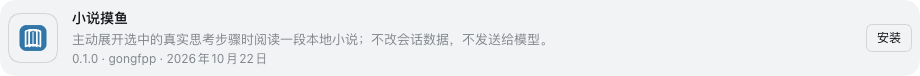

# DSH 插件市场接入

## 这是什么

DSH `0.2.1-rc.2` 的市场由用户信任并添加的静态 JSON 索引提供，默认没有索引源。这不是官方统一商店，也没有“提交一次就自动向所有用户展示”的流程。本项目发布自己的索引，不声称官方审核、推荐或收录。

- 索引地址：<https://raw.githubusercontent.com/gongfpp/dsh-novel-fish/main/index.json>
- 源码仓库：<https://github.com/gongfpp/dsh-novel-fish>
- 包名：`@gongfpp/dsh-novel-fish`

## 在 DSH 内添加

1. 在设置中的实验性功能启用「自定义插件市场」（若「发现」页尚未出现）。
2. 打开插件的「发现」页，通过索引源管理添加上面的 HTTPS 地址。
3. 选择该索引，找到「小说摸鱼 / Novel Fish」，查看版本、来源和兼容范围后安装。
4. 选择最新的 **0.1.4**。按 [README](../README.md#开始读) 导入书籍并勾选原生区域类型。先停用其他接管思考区域的阅读插件；新版本不依赖旧阅读插件。

已添加本索引的用户刷新索引后查看 0.1.4；若显示旧版本，请核对索引 URL 和网络缓存，再刷新插件页面。0.1.0 保留供明确选择旧版本，不作为最新推荐版本。

目标 DSH 的发现页尚不提供原地升级：已安装旧版可用 README 的固定版本命令替换，或先卸载插件再从发现页安装。书库和进度属于当前站点的 IndexedDB，勿清除站点数据。

索引里的 Git 来源固定为完整提交 SHA，不使用浮动分支或可移动 tag。索引可随发布追加版本，但已有版本的源码提交不会悄悄替换。GitHub 安装不要求 npm scope 所有权，也不需要先发布 npm 包。

## 真实 DSH 显示

已在现有 DSH Web `0.2.1-rc.2` 的「发现」页实际添加本索引，显示版本和作者，安装按钮可用；下图只截取真实插件卡片，不含账号、侧栏和会话。此操作没有安装到日常 profile，也没有改变原有阅读插件状态。安装动作在独立空 profile 中验证。

## 格式与官方依据

本索引采用目标版本的 `format: 1` 契约，而不是把未来 master 的新增规则未经验证套进旧版宿主：

- [当前官方插件索引用户指南](https://github.com/deepseek-ai/deepseek-harness/blob/master/docs/user/guide/plugin-market.zh.md)：截至 2026-10-26，仍由用户添加静态索引，不内置统一第三方目录。
- [目标宿主版本的官方索引校验器与格式契约](https://github.com/deepseek-ai/deepseek-harness/blob/dsh-v0.2.1-rc.2/packages/util/plugin-market-index/README.zh.md)
- [当前官方索引服务说明](https://github.com/deepseek-ai/deepseek-harness/blob/master/packages/boot/plugin-market/README.zh.md)

公开 HTTPS 索引已由目标版本的官方解析器验证，其生成的完整 SHA 安装命令已在空 DSH profile 中安装成功，详见 [发布记录](release.md)。添加索引不代表信任所有第三方代码；插件安装后以宿主权限运行，请先检查来源。此仓库添加 `dsh-plugin` topic 供发现，不向目前不接收外部 PR 的宿主源码仓库提交收录 PR。
