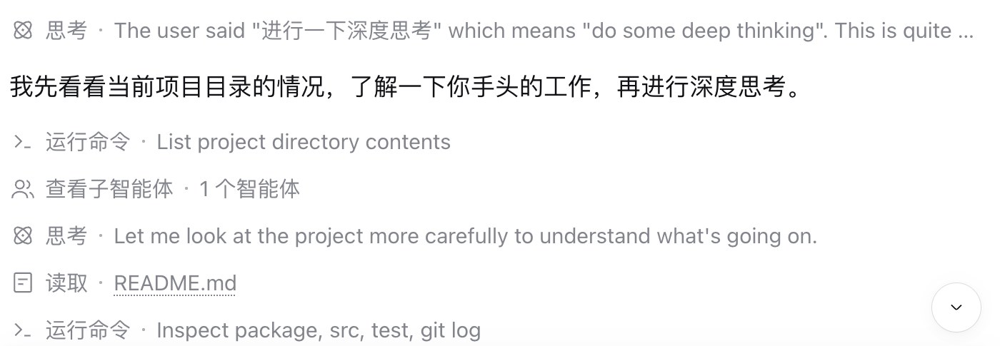
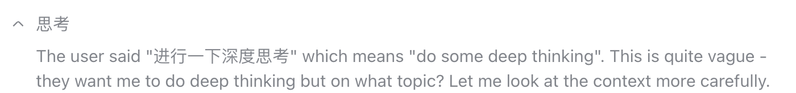

# 0.1.3 只改文字，保留原生图标与折叠行为

## 本轮修正

对照当前安装的 DSH Web `0.2.1-rc.2` 的 `DisclosureRow`、`ReasoningRow`、`TextShimmer` 以及命令／读取／查找行：

- 删除自定义图标、标题覆盖层和聊天内专用 CSS。图标、关闭时的悬停箭头、展开箭头、按钮、标题层、分隔符和原生 shimmer 节点全部保留，不重建折叠行。
- 设置不再提供图标替换；只保留主标题和补充文字的预设／可选自定义。同步修改原生基础文字层与 shimmer 高亮层，避免流式时出现两套文字。没有原生补充文字位置时不另建一行。
- 不接管或重新派发宿主点击、键盘事件。区分原生“整行点击”和“仅左侧按钮点击”两种模式；原生标题在仅按钮模式下不可点击时，插件也不续读。
- 只记录可信的关闭→展开意图，下一帧确认宿主实际展开成功后才读书。嵌套链接、取消的事件、重复键、无效点击、快速开合、切书和已移除的节点不提前消耗内容。
- 真实思考保持在前；小说、加载／失败／书末／等待提示均使用原生正文 Factory。移除额外分隔线、内边距、字号和颜色。转义小说 Markdown，避免引入图片、链接等新的视觉或交互控件。

## 自动验证

`pnpm verify`：**49 项通过，0 失败、0 跳过**。

回归覆盖原生 SVG、箭头、shimmer／布局节点身份和 class 不变；没有注入样式或图标节点；工具行不变；两种原生点击模式；Enter／空格；取消、嵌套控件、快速点击、切书和卸载；真实原文、小说和所有提示均委托原生排版。原有导入、缓存、并发、失败重试和书末测试继续通过。

## 真实宿主验证与限制

已把本地 `0.1.3` 安装到原有 `web` profile，在隔离浏览器中访问原来的 DSH 服务并打开已有真实聊天；没有替换客户端响应或会话数据，也没有发送新聊天消息。验收书仅导入隔离浏览器，不更改日常书库。

真实设置确认只定制文字，导入三段 MD 后显示 `0 / 3`。以明确的合成 DOM 点击展开原生思考时，真实原文正常出现、原生展开箭头正常保留，阅读区提示主动展开；没有把合成事件当成用户续读。原生图标的关闭状态与命令／读取行的对比如下。合成展开再收起后的保存进度仍为 `0 / 3`，详见 [结构化验收记录](evidence/native-disclosure-013-result.json)。截图只裁掉侧栏、账号和无关内容，没有改绘图标或正文。





**本轮未完成原生可信鼠标／键盘的端到端续读复测**：Cua 的可信浏览器点击返回 `route_unavailable`；原生窗口 AX 无法解析且系统截图不可用，后台原生输入被拒绝。没有通过改 `isTrusted` 门控、重写宿主事件或替换其他自动化通道绕过该限制。真实鼠标悬停动画、操作系统键盘焦点和持续模型流式状态，本轮主要依据实际宿主实现及确定性自动测试，不声称已全部人工实测。0.1.2 的 A/B/C 实测仍作为各自版本的历史记录，不冒充本轮证据。

## 本机与发布

本机 `web` profile 使用 `@gongfpp/dsh-novel-fish` **0.1.3**，沿用原书库数据库和每书进度。日常窗口需刷新加载新客户端；不需要安装旧阅读插件。

```sh
dsh plugin --profile web add ./dist/gongfpp-dsh-novel-fish-0.1.3.tgz
```

本轮仅本地提交和产物；未推送、未打标签、未更新 GitHub Release 或市场索引，公开版本仍为 0.1.0。其他 DSH 版本、Desktop、其他浏览器、多标签同步和配额耗尽未验收。标题仍依赖小模块中的特定宿主 DOM 契约，不是稳定公开标题 API。
