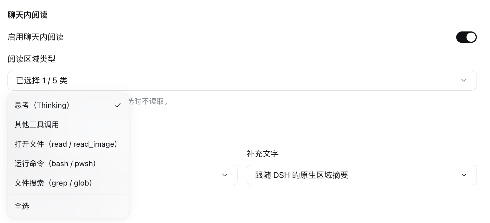

# 0.1.5 原生设置验收

本轮只统一插件详情页的控件和布局，并包含此前未发布的设置入口迁移；不改书库格式、阅读进度或聊天接入。仅适配 DSH Web 0.2.1-rc.2。

## 实现

- 继续使用官方 `plugins.bundle.config`，配置只出现在本插件详情页。
- 按钮、开关、文本输入、单选／多选菜单和删除对话框，均来自宿主的 `@deepseek-ai/dsh-client-ui-primitives`。宿主没有 `Select` 导出，选择器使用原生 `Menu` 和 `Button`，没有仿制浏览器下拉。
- 原始文件 input 隐藏，仅供原生“导入书籍”按钮唤起系统文件选择器；不显示浏览器默认文件控件。
- 移除重复标题和带边框的外层卡片，分为书籍、聊天内阅读和标题显示三组。插件 CSS 只负责布局和宿主主题变量，不重画控件。
- 异步保存、导入和删除阻止重复提交；失败可重试，删除先确认，取消不改数据。既有 IndexedDB 和每本书进度保持不变。

## 真实 DSH 观察（2026-10-29，Asia/Taipei）

在现有 `http://127.0.0.1:3080` 和官方本地插件链接上验证 0.1.5，使用 Cua 创建的隔离浏览器。没有读取或改动用户的书籍。

| 项目 | 结果 |
| --- | --- |
| 插件详情页、原生开关、两列标题布局、无重复外框 | 实际界面可见 |
| 区域类型原生菜单 | 五类和“全选”实际可见；选择后从 1/5 变为 5/5 |
| 主标题选择“自定义…” | 实际出现原生文本输入框 |
| 原生导入按钮 | 通过原生 AX 操作打开系统文件选择器 |
| 新控件下实际文件导入、切书与删除对话框 | 本轮未完成真实 GUI 全流程；有组件行为测试，不以此冒充 GUI 实测 |
| 真实聊天 A/B/C、悬停、键盘和刷新后续读 | 本轮没有重新完成；不把设置截图当作阅读验收 |

菜单与预设选择使用明确的 Cua DOM 设置操作，并逐次读取实际页面结果；不作为“可信手势触发阅读”的证据。文件选择器的后台键盘定位被驱动以 `same_pid_keyboard_ambiguity` 拒绝，没有抢占前台、绕过限制或改用 CDP。旧版文件导入与开关持久化证据保留在 [上一轮记录](plugin-settings-update.md)，不冒充新控件的完整复验。



截图来自实际运行页面，只做裁切，没有重绘。文件 SHA-256：`e46f8dc81533f7b09e6d96aabf4c1697457659d47462906b3af31cd991fdda2d`。

可用本仓库原创的 [三章示例书](evidence/native-settings-sample.md) 手动补验文件导入、当前书籍菜单及删除取消，避免使用私人小说。

## 自动验证

原生组件契约替身用于测试保存中禁用、快速重复操作、导入失败重试、输入内容保留、删除取消／失败／重试，以及客户端构建接入和既有书库进度。替身不证明宿主菜单的键盘、焦点或视觉表现；这些能力仍由 DSH 原生组件提供。

构建和全量测试结果、准确产物与安装回执，见 [发布记录](release.md)。

## 安装与发布边界

GitHub 固定版本安装命令：

```sh
dsh plugin --profile web add github:gongfpp/dsh-novel-fish#v0.1.5
```

npm 目前仍是 0.1.4，不能用未发布的 npm 0.1.5 命令代替以上命令。自建固定 Git 索引与社区市场审核是不同状态；社区更新是否生效以 [市场记录](community-markets.md) 为准。没有改动 DSH 安装文件，也不运行替代 Web 服务器。
