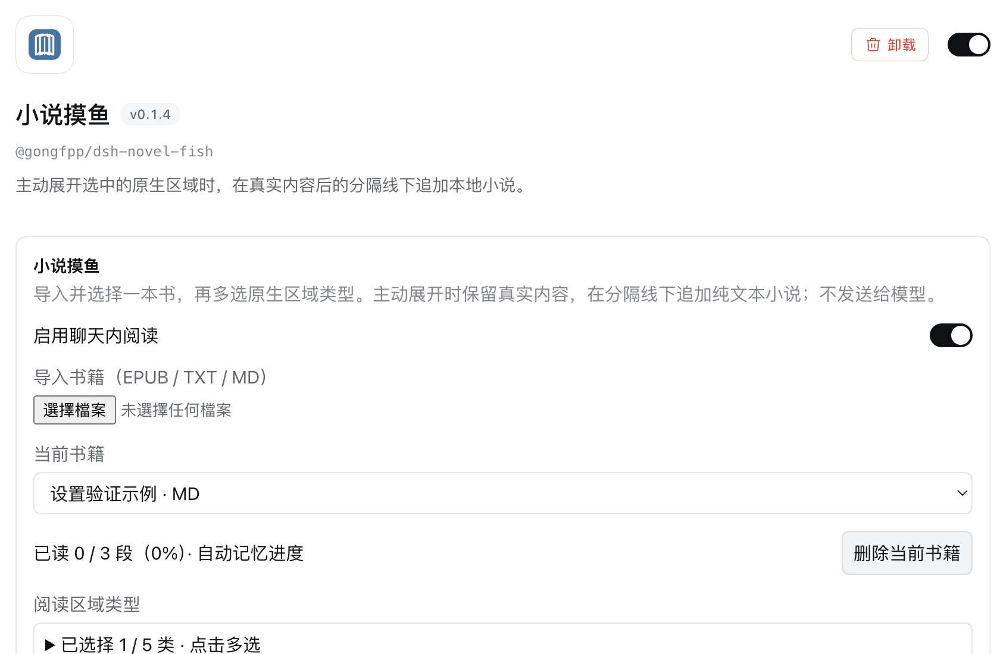

# 插件详情页设置与原生阅读开关

2026-10-29，真实 DSH Web `0.2.1-rc.2`。本轮为**未发布的源码更新**，开发包仍标记 `0.1.4`；不覆盖已发布的 npm 包、Git tag 或市场版本。

## 改动

- 设置从通用设置移至 **插件 → 小说摸鱼详情页**，使用宿主官方 `plugins.bundle.config`，按包名限定在本插件。宿主固定将配置放在说明下、组件列表上方；不移动宿主 DOM。
- 仅“启用聊天内阅读”改用 `@deepseek-ai/dsh-client-ui-primitives` 的原生 `Switch`，与宿主开关共用样式与可访问标签。区域多选仍是复选框。
- 保存时禁用开关并合并连点；保存失败显示错误、不假装已开启，并允许重试。
- 包名、IndexedDB 名称、书籍、进度、状态源、读书逻辑均不变，无迁移。没有修改 DSH 安装文件。

## 真实界面验证

通过 Cua 的精确 Chrome 窗口绑定，在原有 DSH 地址 `http://127.0.0.1:3080` 操作本地开发版；使用隔离浏览器数据目录，不读取或改动日常浏览器的书库。设置操作使用明确的 DOM 输入路线，随后重新读取实际页面确认结果，不把操作回执本身当成成功。

| 检查 | 结果 |
| --- | --- |
| 本插件详情页出现设置 | 已确认；书籍、类型、主标题及补充文字控件可见，配置位于组件列表前。 |
| 原生圆角开关 | 已确认实际外观与 `switch` 语义；不是设置预览或模拟组件。 |
| 关闭并刷新 | 关闭后读取到 `checked=false`；重新加载页面并进入详情，仍为关闭。 |
| 新入口导入文件 | 实际通过文件输入导入原创示例 MD，显示 3 段、进度 `0 / 3`。 |
| 再次开启 | 开关恢复 `checked=true`，示例书仍选中、进度仍为 `0 / 3`。 |
| 通用设置 | 打开真实通用设置对话框，框内未出现小说阅读设置；旧入口注册也由构建产物测试禁止。 |



图片是上述真实界面的裁剪，去掉侧栏、账号、工作区、来源路径及下部内容；没有重绘界面。截图内仍为开发包的 `0.1.4`，不表示相同 npm 版本已获得此改动。

本轮没有发送聊天或模型请求，也没有复验真实聊天 A/B/C、悬停、键盘及流式场景。书库保留由实际构建产物与 `fake-indexeddb` 存储测试覆盖；不将新建示例书冒充用户已有书籍的迁移证明。最后一次界面收尾时，Cua 的自有浏览器生命周期已结束，后续操作遭拒，未绕过限制；截图与表内结果均来自此前成功的页面读取。

## 自动验证

执行 `pnpm verify`：**97 通过、0 失败、0 跳过**。新增覆盖：

- 执行真正的客户端构建产物，只注册本包详情配置，不再注册通用设置，并保留聊天适配注册。
- 读取已有书籍与保存标题，切换开关后，书籍选择、段落、标题和已读进度保持不变。
- 保存期间禁用、快速连点只写一次、失败后报错与重试、书库未就绪或出错时不写入。

测试中的原生 Switch 替身只证明状态与动作；外观由上面的真实宿主截图证明。[设置测试](../test/settings.test.js)、[构建产物集成测试](../test/client.test.js)。

## 本地使用与发布边界

在源码目录完成依赖安装后运行：

```sh
pnpm verify
dsh plugin --profile web add "$PWD"
```

上述本地安装已实际执行；当前 `web` profile 链接此源码目录。刷新已有 DSH 页面后进入 **插件 → 小说摸鱼**。正式 npm `0.1.4` 和固定发布标签保持原样；本轮没有发布新 npm 版本，也没有向市场提交新版本。

## 每次更新都要重新提市场 PR 吗？

**不需要，取决于安装源。** 按 2026-10-28 已核验规则：

- **Awesome 的 npm 安装索引**：包已收录后，发布新的 npm 版本，等待目录自动采集和缓存刷新；一般不为每个版本另提收录 PR，也不能手填该目录禁止的 npm 字段。固定旧 tarball 链接不会自动变成新链接。
- **dshopen 的固定 Git 版本**：在原申请 issue 补充新版本与固定提交，等待复审；不是每次另建 PR。
- **本项目自建索引**：发布后在自己的索引追加新版本和完整提交 SHA，不需第三方市场 PR。
- 其他社区按各自规则；目录更新不等于已安装客户端自动升级，也不保证即时同步。

依据及原申请链接见[公共市场记录](community-markets.md#npm-与清单更新的边界)。
