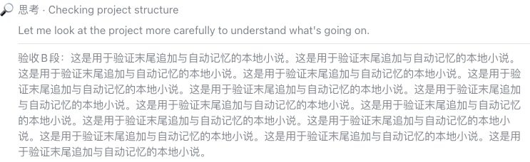

# 0.1.2 按类型选择，在真实思考末尾追加

## 本轮确认的交互

- 设置选“思考（Thinking）”这一**原生区域类型**，适用于任意会话的该类型；不再列出、添加或保存具体轮次／步骤位置。
- 主动展开时，真实思考仍由 DSH 原生 Factory 渲染在前，小说单独追加在后；不覆盖、不修改真实思考，也不插入其句子之间。
- 同一页面重复展开 A 使用临时缓存；首次主动展开另一处 B 才继续。缓存跨组件重挂载保留，但不跨刷新；刷新后从每本书保存的进度继续。
- 自动展开、历史加载、流式更新、组件挂载和模型结束不推进。加载失败、书末、尚无 DOM 身份和关闭阅读时，真实思考仍可见。
- 保留文件导入、书籍下拉、自动保存的进度、图标／标题／补充预设与可选自定义。没有粘贴、具体位置列表、独立阅读器或新增工具类型。

## 实际验证

`pnpm verify`：**46 项通过，0 失败、0 跳过**。新增类型选择、跨会话定位、同节点多个思考区域的独立临时身份、原文始终在前、自动／重复展开不推进和旧位置字段不进入新设置等回归用例。EPUB/TXT/MD、竞态、失败和书末原有测试保持通过。

真实宿主为本机现有 **DSH Web 0.2.1-rc.2**；使用缓存 Chromium `156.0.8078.4` 的独立浏览器上下文，读取现有真实聊天历史。已将 0.1.2 安装到 `web` profile，**没有替换客户端响应、伪造聊天或新建替代服务器**。只向独立测试上下文导入四段验收 MD，不清理或操作日常浏览器的书库。

| 实测 | 结果 |
| --- | --- |
| 设置仅选择原生类型，原生历史思考标题／图标实际改变 | 通过；没有步骤位置列表或持久化 `targets` |
| 历史加载与模拟程序自动展开 | 0/4，不读小说，原始思考可见 |
| 首次主动展开 A | 原始思考在前，小说 A 在后；1/4 |
| A 收起、重挂载、再展开 | 同一段，仍 1/4，原始思考不变 |
| 首次主动展开 B | 小说 B 追加在原文后；2/4 |
| 刷新、自动恢复历史 | 仍 2/4；再次主动展开旧位置读取 C，至 3/4 |
| 关闭阅读开关 | 自定义覆盖和小说追加块消失，真实思考与 3/4 进度保留 |
| 观测的阅读操作网络 | 0 个非 GET 请求、0 个 WebSocket 发送帧；浏览器错误 0 |

完整计数与断言见 [实测结果](evidence/type-append-012-result.json)。截图是实际宿主局部截图，不含账号、侧栏或本机私人路径；聊天截图展示 B 的真实思考及其后的第二段验收小说。




## 本机与发布状态

- 本机 `web` profile 已用 `@gongfpp/dsh-novel-fish` **0.1.2** 替换 0.1.1。原有阅读插件没有新增或叠加启用，不需要安装旧版。
- 沿用原来的站点 IndexedDB 名称和每书进度；未清理站点数据。测试上下文的书籍和开关不改变日常浏览器的本地设置。当前日常窗口需要刷新以加载新客户端。
- 本轮提交和产物仅在本地；**未推送、未打标签、未更新 GitHub Release 或市场索引**。公开安装地址仍为 0.1.0，不会获取本轮交互。

本地重新安装：

```sh
dsh plugin --profile web add ./dist/gongfpp-dsh-novel-fish-0.1.2.tgz
```

## 限制

当前只支持原生“思考”类型，不承诺支持工具日志等其他类型。标题／图标仍是集中在小模块的宿主 DOM 窄适配；只有页面已加载且有思考正文的区域可阅读。其他 DSH 版本、Desktop 和其他浏览器未验证。流式更新、异常和并发主要由自动测试覆盖；配额耗尽、断电和多标签同步未实测。没有改写会话数据或将小说交给模型。
